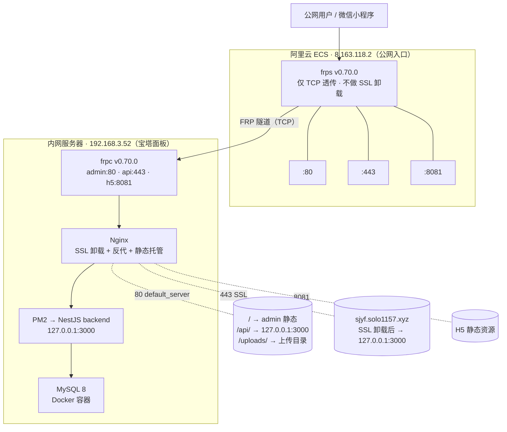
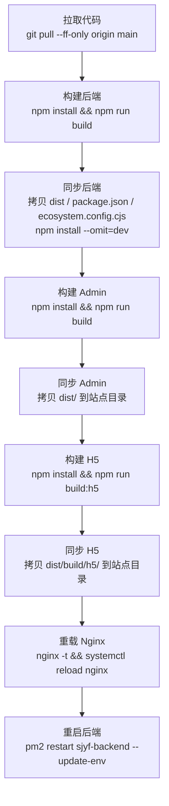

# 拾家有方 · 生产部署架构与部署流程

> 本文档描述当前生产环境的部署架构、服务器角色、网络拓扑，以及日常代码发布的标准流程。
> 所有历史部署文档如有冲突，以本文档为准。

---

## 一、生产环境架构总览

### 1.1 服务器角色

| 服务器 | 位置 | 角色 | 关键组件 |
|-------|------|------|---------|
| `8.163.118.2` | 阿里云 ECS（公网） | FRP 服务端，仅做 TCP 透传 | frps v0.70.0 |
| `192.168.3.52` | 内网 | 业务服务器 | 宝塔面板 + Nginx + PM2 + MySQL |

### 1.2 网络拓扑



### 1.3 域名与访问方式

| 服务 | 访问地址 | 说明 |
|------|---------|------|
| 管理后台 Admin | `http://8.163.118.2/` | 公网 IP 直连，无需域名 |
| 后端 API | `https://sjyf.solo1157.xyz/api/*` | 微信小程序使用，**待 ICP 备案通过** |
| 小程序 H5 | `http://8.163.118.2:8081/` | 调试用 |

> **当前状态**：`sjyf.solo1157.xyz` 尚未完成阿里云 ICP 备案，阿里云对该域名的 80/443 端口请求做拦截（80 返回 403 备案页，443 通过 SNI 重置连接）。备案通过前，公网用域名访问不可用；用 IP 访问不受影响。

---

## 二、内网服务器目录结构

内网 `192.168.3.52` 上的目录约定：

```
/www/wwwroot/shijia/
├── app/                    # GitHub 拉取的源码目录
│   ├── backend/
│   ├── admin/
│   └── miniapp/
├── backend/                # 后端运行目录
│   ├── dist/               # 构建产物
│   ├── node_modules/
│   ├── .env.production     # 生产环境变量（不进 Git）
│   └── ecosystem.config.cjs
├── sites/
│   ├── admin/dist/         # Admin 构建产物
│   ├── api/                # API 站点根目录（含 .well-known）
│   └── h5/dist/            # H5 构建产物
├── data/
│   └── uploads/            # 上传文件持久化目录
└── logs/                   # 应用日志
```

---

## 三、关键配置文件

### 3.1 FRP 配置

| 文件 | 位置 | 说明 |
|------|------|------|
| `frps.ini` | `8.163.118.2:/etc/frp/frps.ini` | 公网 frps 配置 |
| `frpc.ini` | `192.168.3.52:/etc/frp/frpc.ini` | 内网 frpc 配置 |

仓库内同步副本：`docs/deploy/frp/frps.ini`、`docs/deploy/frp/frpc.ini`

### 3.2 Nginx 配置

| 站点 | 配置文件 | 说明 |
|------|---------|------|
| Admin（80 default） | `/www/server/panel/vhost/nginx/0.default.conf` 或自定义 | 托管 admin 静态 + /api 反代 |
| API（443 SSL） | `/www/server/panel/vhost/nginx/sjyf.solo1157.xyz.conf` | SSL 卸载 + /api 反代 |
| H5（8081） | 宝塔对应站点配置 | 托管 H5 静态 |

仓库内配置模板：`docs/deploy/deploy-config/`

### 3.3 后端进程

- 进程管理器：PM2
- 配置文件：`backend/ecosystem.config.cjs`
- 应用名：`sjyf-backend`
- 监听端口：`3000`

---

## 四、日常部署流程（代码发布）

### 4.1 前置条件

- 代码已提交并推送到 GitHub 远端 `main` 分支
- 内网 `192.168.3.52` 可访问 GitHub（已配置 SSH 免密）
- 后端 `.env.production` 已存在于 `/www/wwwroot/shijia/backend/`

### 4.2 发布步骤

在内网服务器 `192.168.3.52` 上执行：

```bash
cd /www/wwwroot/shijia/app
bash code/scripts/deploy/deploy-code.sh main
```

脚本执行流程：



### 4.3 发布后验证

```bash
# 进程状态
pm2 status sjyf-backend
nginx -t

# 服务可用性（从公网 8.163.118.2 本地测试，绕过阿里云备案拦截）
curl -I http://8.163.118.2/                                          # Admin 首页 200
curl -I --resolve sjyf.solo1157.xyz:443:127.0.0.1 https://sjyf.solo1157.xyz/api/docs  # API 文档
curl -I http://8.163.118.2:8081/                                      # H5 首页
```

### 4.4 回滚

```bash
cd /www/wwwroot/shijia/app
git log --oneline -n 5                          # 查看最近提交
git checkout <目标提交哈希>                      # 回退到指定版本
bash code/scripts/deploy/deploy-code.sh         # 重新发布
```

> 回滚只回退代码版本，不回滚数据库和上传目录。

---

## 五、首次部署流程（新服务器初始化）

### 5.1 公网服务器 8.163.118.2

1. 安装 frps v0.70.0
2. 配置 `frps.ini`（`bind_port = 7000`，设置 token）
3. 开放安全组：7000、80、443、8081
4. 启动 frps：`systemctl start frps && systemctl enable frps`

### 5.2 内网服务器 192.168.3.52

1. 安装宝塔面板
2. 安装 Nginx、MySQL 8（Docker）、Node.js、PM2
3. 安装 frpc v0.70.0，配置 `frpc.ini`，启动 frpc
4. 创建 MySQL 数据库和业务账号
5. 在宝塔创建站点：
   - Admin（80，default_server）
   - API（443，sjyf.solo1157.xyz，配置 SSL 证书）
   - H5（8081）
6. 准备后端 `.env.production`
7. 执行 `init-server.sh` 拉取代码并初始化目录
8. 执行 `deploy-code.sh` 完成首次构建发布

---

## 六、SSL 证书管理

### 6.1 当前状态

- 证书文件位置：`/www/server/panel/vhost/cert/sjyf.solo1157.xyz/`
  - `fullchain.pem`
  - `privkey.pem`
- 证书签发：Let's Encrypt
- 有效期：约 90 天

### 6.2 续签方式

**方式 A（推荐，备案通过后）**：在宝塔面板 → 站点 → SSL → Let's Encrypt 自动续签

**方式 B（手动）**：使用 `certbot` 或 `acme.sh` 手动续签，然后 reload nginx

### 6.3 备案期间的临时方案

由于域名未备案，Let's Encrypt HTTP-01 验证（80 端口）被阿里云拦截。可使用 **DNS-01 验证**方式申请/续签证书：

```bash
# 示例：使用 acme.sh + 阿里云 DNS API
acme.sh --issue --dns dns_ali -d sjyf.solo1157.xyz
```

---

## 七、ICP 备案说明

### 7.1 当前状态

`Sjyf.solo1157.xyz` **未完成**阿里云 ICP 备案，导致：

- 公网用域名访问 80 端口 → 阿里云返回 403 备案拦截页
- 公网用域名访问 443 端口 → 阿里云通过 SNI 检测后重置 TCP 连接
- 用 IP 访问不受影响

### 7.2 备案要求

- 备案类型：**企业备案**（家政服务属经营性业务，个人备案不合规）
- 所需材料：营业执照、法人身份证、域名证书等
- 审核周期：约 15-20 个工作日
- 备案入口：[阿里云备案控制台](https://beian.aliyun.com/)

### 7.3 备案通过后

阿里云自动解除拦截，无需额外操作。届时验证全链路：

```bash
# 从公网任意位置测试
curl -I https://sjyf.solo1157.xyz/api/health     # 应返回 200
curl -I http://sjyf.solo1157.xyz/                 # 应 301 跳转到 HTTPS
```

---

## 八、运维常用命令

### 8.1 进程管理

```bash
pm2 status                    # 查看进程状态
pm2 logs sjyf-backend         # 查看后端日志
pm2 restart sjyf-backend      # 重启后端
pm2 stop sjyf-backend         # 停止后端
```

### 8.2 FRP 管理

```bash
# 公网服务器
systemctl status frps
systemctl restart frps

# 内网服务器
systemctl status frpc
systemctl restart frpc
```

### 8.3 Nginx 管理

```bash
nginx -t                      # 配置语法检查
systemctl reload nginx        # 平滑重载
systemctl restart nginx       # 重启
```

### 8.4 日志查看

```bash
# Nginx 访问日志
tail -f /www/wwwlogs/sjyf.solo1157.xyz.log

# 后端日志
tail -f /www/wwwroot/shijia/logs/sjyf-backend-out.log
```

---

## 九、配置文件索引

| 用途 | 仓库路径 |
|------|---------|
| frps 配置 | [docs/deploy/frp/frps.ini](file:///d:/trae_workspaces/拾家有方项目/docs/deploy/frp/frps.ini) |
| frpc 配置 | [docs/deploy/frp/frpc.ini](file:///d:/trae_workspaces/拾家有方项目/docs/deploy/frp/frpc.ini) |
| Admin Nginx 配置 | [docs/deploy/deploy-config/nginx.bt-panel-admin.conf](file:///d:/trae_workspaces/拾家有方项目/docs/deploy/deploy-config/nginx.bt-panel-admin.conf) |
| API SSL Nginx 配置 | [docs/deploy/deploy-config/nginx.bt-panel-backend-ssl.conf](file:///d:/trae_workspaces/拾家有方项目/docs/deploy/deploy-config/nginx.bt-panel-backend-ssl.conf) |
| 部署脚本 | [code/scripts/deploy/](file:///d:/trae_workspaces/拾家有方项目/code/scripts/deploy/) |
| 后端 PM2 配置 | [backend/ecosystem.config.cjs](file:///d:/trae_workspaces/拾家有方项目/backend/ecosystem.config.cjs) |
| 小程序 API 域名配置 | [code/miniapp/vite.config.ts](file:///d:/trae_workspaces/拾家有方项目/code/miniapp/vite.config.ts) |
